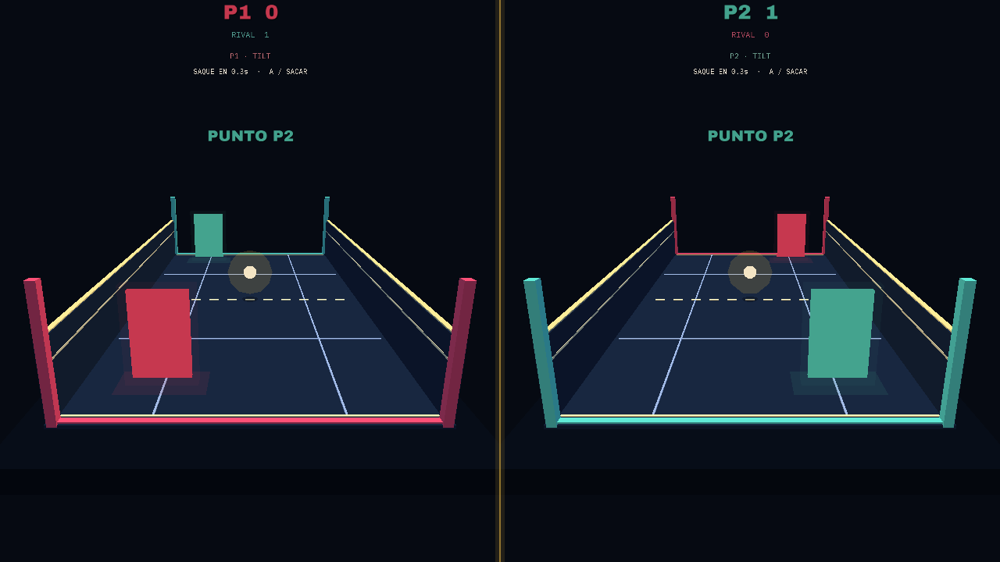

# Juan Manuel Schillaci

**Senior Backend Developer & Software Architect** · **AI Engineering**.
Hace más de 25 años que programo en Python. Fundé en 2010
[Devecoop](https://devecoop.coop.ar), una cooperativa de trabajo de software.
Desarrollo **Toxinator**, una consola de juegos 3D con Panda3D y controladores
por celular.

[LinkedIn](https://www.linkedin.com/in/jmschillaci/) · [GitHub](https://github.com/skalanux) · Argentina
[English](README.md) · **Español**

## Sobre mí

Empecé a programar juegos en la adolescencia y nunca lo dejé del todo:
Toxinator es, un poco, una vuelta a esa idea. Antes de fundar Devecoop en 2010
trabajé en distintos equipos y proyectos; hoy, en Devecoop, hago backend,
arquitectura, producto y AI Engineering.

Me gustan los problemas de arquitectura, rendimiento y automatización: APIs,
plataformas de datos, integraciones y sistemas que tienen que funcionar a
escala. También me gusta aplicarlo en herramientas para Linux, juegos y
experimentos de IA.

- **Backend:** Python, Django, Django REST Framework, FastAPI, SQL, APIs REST.
- **AI Engineering:** LLMs, RAG, automatización y productos con IA.
- **Sistemas:** Linux, Ansible, chezmoi, SNMP, WebSocket y C++ cuando el
  problema lo pide.
- **Juegos y 3D:** Panda3D, PWA y controladores por celular.
- **Idiomas:** español e inglés (bilingüe); chino mandarín (HSK 2).

## Ahora: Toxinator

Es con lo que me estoy divirtiendo: una consola de juegos 3D personal, con un
runtime en Python/Panda3D, un launcher, controladores por celular y juegos que
se cargan como plugins.

Pong 3D es el primer juego: duelo a pantalla dividida, con inclinación del
celular y fallback táctil.

- [Consola Toxinator](https://github.com/skalanux/toxinator) — runtime, launcher
  y API de juegos.
- [Pong 3D](https://github.com/skalanux/pong) — duelo 3D a pantalla dividida,
  con inclinación del celular y fallback táctil.

## Salvando la cena / Pytari

En el PyCamp 2022 participé de
[Salvando la cena](https://github.com/PyAr/SalvandoLaCena), un juego cooperativo
para dos personas que combina electrónica y habilidad: una persona controla al
personaje y la otra controla el tiempo con un volante conectado a un
potenciómetro.

Después construimos **Pytari**, una consola basada en esa electrónica, y la
presentamos en el [PyDay Santa Fe 2022](https://www.python.org.ar/eventos/123/).

## Open source

- **[django-scotty](https://github.com/skalanux/django-scotty)** — vistas de
  tablas avanzadas para Django: CRUD, filtros, exportación a Excel, acciones
  masivas y modales con htmx.
- **[django-remote-scenario](https://github.com/skalanux/django-remote-scenario)**
  — setup remoto de escenarios para tests end-to-end de proyectos Django.
- **[qrauth](https://github.com/skalanux/qrauth)** — herramienta local para
  migrar cuentas de Google Authenticator a otros gestores TOTP sin subir nada a
  la red.
- **[puntofiles](https://github.com/skalanux/puntofiles)** — bootstrap de
  estaciones de trabajo con Ansible y chezmoi.

## AI Engineering

- **[RAG Manuales](https://devecoop.coop.ar/casos-de-exito.html#investigacion)** —
  investigación aplicada en Devecoop para responder en lenguaje natural sobre
  documentación oficial.
- **[trendsearch](https://github.com/skalanux/trendsearch)** — API FastAPI +
  Azure para buscar tendencias.
- **[laburator](https://github.com/skalanux/laburator)** — búsqueda de trabajo
  asistida por IA.
- **[llmwiki](https://github.com/skalanux/llmwiki)** — experimento de wiki con
  LLMs.

## Experimentos

- **Web:** [react-mislupins](https://github.com/skalanux/react-mislupins) y
  [mislupin](https://github.com/skalanux/mislupin), herramientas para gestionar
  colecciones de la revista Lúpin.

## Comunidad y eventos

**Lanux (2002–2019).** Cofundé el Grupo de Usuarios de GNU/Linux de Lanús
"Lanux" en 2002. Desde entonces di charlas, organicé eventos y difundí Linux por
Argentina y Brasil. Notas que mencionan a Lanux:
[Infobae](https://www.infobae.com/economia/2022/05/05/unicornio-desconocido-nacio-en-lanus-aprendio-a-programar-solo-y-sorprende-al-mundo-con-su-startup-de-usd-2500-millones/)
(sobre Guillermo Rauch) y
[Faster Than Normal](https://fasterthannormal.co/people/guillermo-rauch).

- **2008 — OLPC Game Jam, Brasil.** Con el equipo argentino (Misol, Solar,
  Lanux, PyAR y Cafelug) ganamos el primer premio con **Falabracman**.
  [Nota](https://sistemas.com/12882.php).
- **2002–2019 — Lanux y FLISoL.** Organicé reuniones y FLISoL en la Universidad
  Argentina John F. Kennedy y en la UNLA.
  [FLISoL Lanús 2016](https://es.linkedin.com/pulse/flisol-2016-en-lan%C3%BAs-juan-manuel-schillaci).
- **2011 — Conurbania.** Organicé en la UNLA un evento de charlas sobre software
  libre.
- **2016 — PyConAr Bahía Blanca.** Coorganicé la conferencia; fue una
  experiencia inolvidable.
- **2025 — Punto Coop.** Ideé y coorganicé
  [Punto Coop 2025](https://punto.coop.ar/events/punto-coop-2025/), un encuentro
  de tecnología, cooperación y transformación social.
- **Actualidad — PyDay Hurlingham.** Coorganizo el
  [PyDay Hurlingham](https://eventos.python.org.ar/events/pyday-hurlingham-2026),
  que en 2026 tuvo su tercera edición en la UNAHUR.

Soy miembro de [PyAR](https://ac.python.org.ar/) y de la
[Python Software Foundation](https://www.python.org/psf/).

### Charlas

- [docopt](https://github.com/skalanux/docopt-talk) —
  [video](https://www.youtube.com/watch?v=df4vKnINyy0&t=1090s) — PyConAr 2016.
- [“Matar a React”](https://github.com/skalanux/matar-a-react) —
  [video](https://www.youtube.com/watch?v=lvzwFRhOIyY&t=7s) — sobre la web simple
  con htmx; Punto Coop 2025.

## Formación y certificaciones

- Universidad Argentina John F. Kennedy.
- **IA con redes neuronales** — 10Pines, 2023.
- **AWS Discovery Day** — IT College, 2020.
- **HSK 2** — Chinese Testing International, 2013.

## Contacto

- [LinkedIn](https://www.linkedin.com/in/jmschillaci/) — experiencia completa y
  recomendaciones.
- [GitHub](https://github.com/skalanux)
- [Devecoop](https://devecoop.coop.ar) — la cooperativa que fundé en 2010.
- Proyecto: [Toxinator](https://github.com/skalanux/toxinator)
