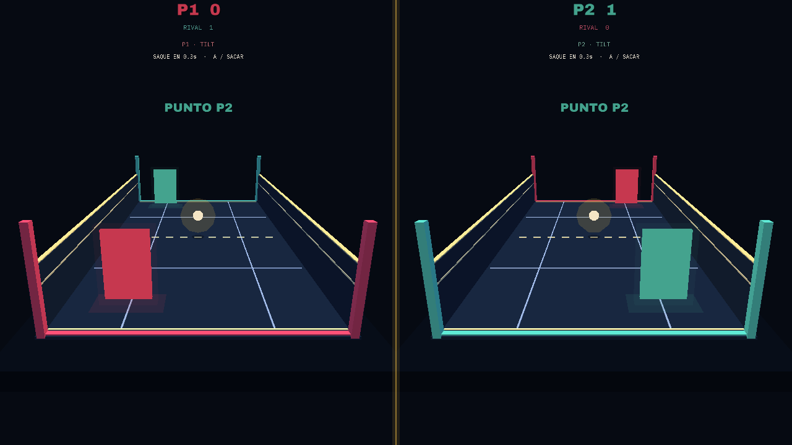

# Juan Manuel Schillaci

**Senior Backend Developer & Software Architect** con más de 25 años de
experiencia diseñando y construyendo sistemas en Python. Trabajo en
[Devecoop](https://www.linkedin.com/company/devecoop-software/) y desarrollo
**Toxinator**, una consola de juegos 3D con Panda3D y controladores por celular.

[LinkedIn](https://www.linkedin.com/in/jmschillaci/) · [GitHub](https://github.com/skalanux) · Argentina

## Sobre mí

Disfruto los problemas de arquitectura, rendimiento y automatización: APIs,
plataformas de datos, integraciones y sistemas que tienen que funcionar a
escala. También me gusta bajarlo a tierra en herramientas para Linux, juegos y
experimentos de IA.

- **Backend:** Python, Django, Django REST Framework, FastAPI, SQL, APIs REST.
- **Sistemas:** Linux, Ansible, chezmoi, SNMP, WebSocket y C++ cuando el
  problema lo pide.
- **Juegos y 3D:** Panda3D, PWA y controladores por celular.
- **Idiomas:** español e inglés (bilingüe); chino mandarín (HSK 2).

## Con lo que me estoy divirtiendo ahora: Toxinator

Toxinator es una consola de juegos 3D personal: un runtime en Python/Panda3D,
un launcher, controladores por celular y juegos que se cargan como plugins.
Pong 3D es el primer juego: duelo a pantalla dividida, con inclinación del
celular y fallback táctil.

- [Consola Toxinator](https://github.com/skalanux/toxinator) — runtime, launcher
  y API de juegos.
- [Pong 3D](https://github.com/skalanux/pong) — duelo 3D a pantalla dividida,
  con inclinación del celular y fallback táctil.

## Herramientas que mantengo y colaboro

- **[django-scotty](https://github.com/skalanux/django-scotty)** — vistas de
  tablas avanzadas para Django: CRUD, filtros, exportación a Excel, acciones
  masivas y modales con htmx.

- **[puntofiles](https://github.com/skalanux/puntofiles)** — bootstrap de
  estaciones de trabajo con Ansible y chezmoi.

## Herramientas y experimentos

- **Automatización y Linux:** `puntofiles`, dotfiles con `vcsh`, scripts de
  setup.
- **IA y datos:** [trendsearch](https://github.com/skalanux/trendsearch)
  (FastAPI + Azure), [laburator](https://github.com/skalanux/laburator)
  (búsqueda de trabajo asistida por IA) y
  [llmwiki](https://github.com/skalanux/llmwiki) (experimento de wiki con LLMs).
- **Web:** [react-mislupins](https://github.com/skalanux/react-mislupins) y
  [mislupin](https://github.com/skalanux/mislupin), herramientas para gestionar
  colecciones de la revista Lúpin.
- **[qrauth](https://github.com/skalanux/qrauth)** — herramienta local para
  migrar cuentas de Google Authenticator a otros gestores TOTP sin subir nada a
  la red.

## Salvando la cena.
En el Pycamp 2022, participé del proyecto Salvando la cena, un juego que combina electrónica y habilidad para jugar en parejas https://github.com/PyAr/SalvandoLaCena. Gracias a esto construimos el proyecto llamado Pytari, una consola que hace uso de la electrónica que hicimos, dimos una charla en el Pyday SantaFe de 2022 https://www.python.org.ar/eventos/123/.

## Comunidad
  En mis 20's Co-Funde el Grupo de usuarios de GNU/Linux de la ciudad de Lanús "Lanux" en 2002, dando charlas, hosteando eventos y difundiendo Linux por toda la Argentina y Brasil. 
  
  Algunas notas que mencionan a Lanux.
  
  https://www.infobae.com/economia/2022/05/05/unicornio-desconocido-nacio-en-lanus-aprendio-a-programar-solo-y-sorprende-al-mundo-con-su-startup-de-usd-2500-millones/
  https://fasterthannormal.co/people/guillermo-rauch
  
  
  Junto con otros grupos como Pyar y Misol, ganamos un concurso de desarrollo de juegos en Python para la OLPC en 2008
  https://sistemas.com/12882.php

De 2002 a 2019 Organicé reuniones de Lanux y Flisol en la Universidad Argentina John F Kennedy en la UNLA
En 2011 Organicé Conurbania, un evento de charlas sobre software liibre en la UNLA
En 2025 Ideé y Co organicé https://punto.coop.ar/events/punto-coop-2025/
En 2016 Co-organicé la PyconAr de Bahía Blanca, fue una experiencia inolvidable. 
Actualmente Co-organizo el Pyday de Hurlingham que en el año 2026 tuvo su 3era Edición en la UNAHUR. Soy miembro de Pyar, y de la Python Software foundation.
  
- Charlas: [docopt](https://github.com/skalanux/docopt-talk) https://www.youtube.com/watch?v=df4vKnINyy0&t=1090s en PyConAr 2016
- [“Matar a React”](https://github.com/skalanux/matar-a-react) https://www.youtube.com/watch?v=lvzwFRhOIyY&t=7s sobre la web  simple con htmx.

## Formación y certificaciones

- Universidad Argentina John F. Kennedy.
- **IA con redes neuronales** — 10Pines, 2023.
- **AWS Discovery Day** — IT College, 2020.
- **HSK 2** — Chinese Testing International, 2013.

## Contacto

- [LinkedIn](https://www.linkedin.com/in/jmschillaci/) — experiencia completa y
  recomendaciones.
- [GitHub](https://github.com/skalanux)
- Proyecto: [Toxinator](https://github.com/skalanux/toxinator)
